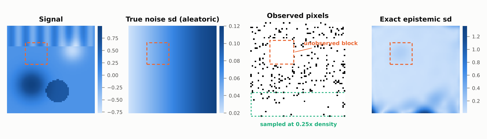
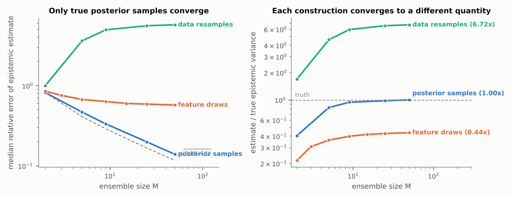
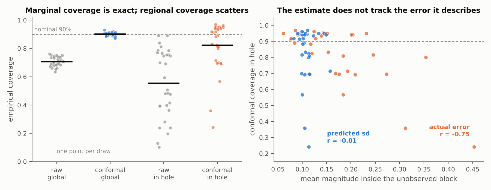

# When the aleatoric–epistemic split is exact and still does not help

**A pre-registered study on a model whose posterior is available in closed form, so the
true aleatoric and epistemic terms are known rather than estimated.**

Three of four pre-registered predictions failed. The failures are the result.

---

## Headline

In a Bayesian model where the uncertainty decomposition can be computed exactly:

1. **Ensembling does not converge on the epistemic term.** A deep ensemble's spread is an
   unbiased estimate of epistemic variance only if its members are posterior samples. They
   are not. Members that differ by random initialisation settle at **0.44×** the true
   epistemic variance; members that differ by bootstrap resampling settle at **6.72×**.
   Both miss by a constant that more members do not reduce. Only true posterior samples
   converge, at the theoretical rate (fitted exponent −0.457 against −0.5).
2. **The two terms are entangled by definition, not by estimation error.** Doubling the
   observation noise — a purely aleatoric intervention — multiplies the *exact* epistemic
   variance by **3.63** (analytic ceiling for this model: 4.00). No better estimator can
   remove this. The decomposition does not separate the model's ignorance from the world's
   randomness, because the posterior's width depends on the noise level by construction.
3. **The undecomposed total is more accurate than either of its parts.** At M = 50 the
   estimated epistemic term is **0.44×** the truth and the estimated aleatoric term is
   **1.43×** the truth, but the total they sum to is **1.10×**. The two errors run in
   opposite directions and partly cancel. Splitting a quantity you can estimate to within
   10% into two parts you can only estimate to within a factor of two or three is a poor
   trade unless the split buys something, which is what H3 tests.
4. **Where the model saw nothing, the uncertainty estimate carries almost no information
   about the error.** Across statistically identical draws, true extrapolation error inside
   an unobserved block varies by **7.4×** while the predicted uncertainty there varies by
   **1.9×**, and the two are uncorrelated (r = −0.01). Conformal calibration fixes the
   marginal number exactly (0.900 nominal, 27/30 draws inside [0.88, 0.92]) and leaves
   regional coverage swinging between **0.24 and 0.97**.

The practical reading: an uncertainty estimate can be exactly computed, correctly
calibrated on average, and still be uninformative precisely where a user would most want to
trust it.

---

## What this adds to the baseline study

The [study 1](../study-1-sweeps) fitted implicit neural representations to a synthetic
image and measured the decomposition against injected causes. It reached a negative result
but could not say *why*, because with an ensemble of nine networks there is no way to
separate three candidate explanations: a bad estimator, too few members, or a decomposition
that does not do what it claims.

This study removes that ambiguity by changing one thing. The first layer of the baseline's
INR is a bank of fixed random Fourier features; replacing the trained layers above it with
a Bayesian linear head gives **random-feature Bayesian linear regression** — a close
analogue of the same model with a posterior in closed form. Every quantity the baseline had
to estimate is now available exactly, so estimates can be scored against truth instead of
against each other.

Where the two disagree, this one is better powered. An earlier exploratory run of mine
reported the epistemic term *losing* to total predictive variance at flagging errors
(AUROC 0.81 vs 0.83, one draw, interval containing zero). With exact terms and 30 draws the
sign reverses: epistemic wins by **+0.026 [+0.020, +0.033]**.

*That earlier run's code was not recoverable, so it is not included in this repository and
its numbers are not offered as evidence here — only as the reason this study was run. Every
number below is reproduced by the scripts in this folder; every number attributed to study 1
is reproduced by the grids in [its folder](../study-1-sweeps).*

---

## Setup



A 64×64 field is built so every cause of uncertainty is known in advance:

| Component | Ground truth |
|---|---|
| Signal | smooth blobs, a sharp-edged disc, and a striped band — deliberately not band-limited, so the smooth prior is misspecified where the edges are |
| Aleatoric | noise standard deviation rising linearly left to right, 0.02 → 0.12 |
| Epistemic | 8% of pixels observed, with a 16×16 block observed **never** (verified: zero observed pixels inside it across all 30 draws) and a band sampled at 0.25× density |

The model is a Bayesian linear head on 512 random Fourier features. Its posterior
covariance is `(Φᵀ W Φ + αI)⁻¹` with `W = diag(1/σ²)`, so the exact epistemic variance at
any pixel is `φᵀ Σ φ` and the exact aleatoric variance is the known noise map. The
practitioner's estimator — ensemble spread for epistemic, mean of per-member predicted
variances for aleatoric — is computed alongside it from ensembles of 2 to 50 members, each
member carrying its own feature draw and its own squared-residual noise head, mirroring the
baseline's Gaussian NLL heads.

30 independent draws per condition, two noise conditions, 886s of CPU. All hypotheses,
thresholds and accept/reject rules were fixed in `preregistration.md` before any result
existed.

---

## Pre-registered results

| | Prediction | Outcome |
|---|---|---|
| **H1** | ensemble epistemic error falls as `(M−1)^−0.5`; exponent in [−0.65, −0.35] | **REJECTED** — exponent −0.102 [−0.133, −0.090] |
| **H2** | doubling noise raises *exact* epistemic variance by >10% | **ACCEPTED** — ratio 3.63 [3.61, 3.65], but see below |
| **H3** | *(null)* exact epistemic term is no better than total variance at flagging errors | **NULL REJECTED** — epistemic wins by +0.026 [+0.020, +0.033] |
| **H4** | conformal restores marginal coverage to [0.88, 0.92] while hole coverage stays <0.88, in ≥25/30 draws | **REJECTED** — both held in 13/30 |

Full tests in [`RESULTS.md`](RESULTS.md); the post-hoc analyses that explain the three
failures are in [`SECONDARY.md`](SECONDARY.md) and are labelled exploratory throughout.

### H1 — the finite-ensemble story was wrong, and the truth is worse



H1 assumed the gap between ensemble estimate and true epistemic variance was sampling
error that more members would close. Fitting `a(M−1)^b + c` to the measured error finds a
floor of **c = 0.543** — at M = 50, 95% of the remaining error is floor.

To test whether this is the estimator's fault, three ensembles were built on identical
data, differing only in what makes members differ. Exact posterior samples recover the
theoretical rate and converge on the truth (1.00× at M = 50). Feature draws — the standard
construction, and the one a deep ensemble of INRs uses — converge to 0.44×. Bootstrap
resamples converge to 6.72×.

So the estimator is fine. The members are the problem: an ensemble's spread measures
disagreement between whatever perturbation distinguishes its members, which equals the
posterior's epistemic variance only when that perturbation *is* the posterior. The two
common constructions miss in opposite directions, which rules out a correction factor a
practitioner could apply without already knowing the answer.

### H2 — accepted, and that is the uncomfortable part

The threshold of 10% was far too lax to be informative; in hindsight this was a badly
specified hypothesis. The measured 3.63 sits just under the ceiling of 4.00 that this
model's algebra predicts, since doubling every noise standard deviation divides `W` by four
and inflates the whole posterior covariance accordingly, falling slightly short only
because the prior precision does not scale.

Study 1 shows the same effect in the trained INR, where it can be checked: across its noise
sweep the epistemic term `E` rises **13.3×** from 1% to 100% noise, and a doubling at the
high end (32% → 66%) multiplies it by **2.69×**, against 3.63× here. A quantity meant to
measure the model's ignorance tracks the data's noise in both model families. A purely aleatoric intervention moves the exact epistemic term by
nearly a factor of four, which means the claim that these two quantities separate model
ignorance from data noise is wrong at the level of the definition. No estimator improvement
addresses it.

### Both terms are biased at convergence, and the biases cancel

| quantity at M = 50 | estimate / truth |
|---|---|
| epistemic term | 0.44× |
| aleatoric term | 1.43× [1.35, 1.54] |
| **total predictive variance** | **1.10× [0.77, 1.36]** |

The aleatoric estimate drifts *upward* with M (1.31× at M = 2, 1.43× at M = 50) — it too
converges to a biased limit rather than to the truth, because each member's noise head
absorbs part of the model's own misfit at the disc edge and the striped band. Epistemic
variance is 33% of the total here, and the two biases run opposite ways, so the total is
the best-estimated quantity on the page. Study 3 explains the aleatoric half from the other
side: the head reports the training residual, so its bias is set by where the fit sits
relative to the noise floor — a median of 0.26× where the model has memorised the noise and
9.78× where it has underfitted. A bias that depends on where the misfit lands looks like an
unstable constant when it is measured once.

### H3 — the split helps, slightly, and only for one of two questions

| target | total variance | epistemic only | aleatoric only | epistemic − total |
|---|---|---|---|---|
| error vs clean signal | 0.798 | 0.826 | 0.545 | +0.028 [+0.023, +0.034] |
| error vs noisy observation | 0.801 | 0.822 | 0.568 | +0.021 [+0.016, +0.027] |

The null was rejected, but the effect is ~0.02–0.03 AUROC. Ranking and calibration are
different jobs: the epistemic term ranks pixels slightly better on both targets, while
total variance is the quantity with the correct width for predicting the next observation.
A single AUROC answers only the first, which is a plausible source of the disagreement in
the published literature on whether the split earns its keep.

### H4 — conformal does exactly what it promises, and that is the problem



Global coverage after conformal scaling: **0.900**, inside the pre-registered band in 27 of
30 draws. Inside the unobserved block: mean 0.822, **median 0.902**, min 0.242, max 0.969,
sd 0.178. The joint condition failed because conditional coverage is not reliably low — it
is reliably *unpredictable*.

The scene, the block and its contents are identical in every draw; only the sampling mask
and the noise change. Tracing the swing:

| quantity | spread across draws | correlation with hole coverage |
|---|---|---|
| conformal quantile `q` | 1.4× | −0.04 [−0.32, +0.22] |
| predicted sd inside hole | 1.9× | −0.01 [−0.31, +0.26] |
| **actual error inside hole** | **7.4×** | **−0.75 [−0.90, −0.42]** |

The uncertainty estimate inside the unobserved region is close to constant while the error
it is supposed to describe varies sevenfold, and the two are uncorrelated. This is not
miscalibration that a margin could fix. The exact Bayesian posterior does not help, because
a posterior's variance in an unobserved region is set by the prior and the sampling
geometry — not by what the unseen signal happens to do there. Conformal prediction then
rescales a quantity that was uninformative there to begin with, which is precisely why it
delivers a correct marginal number and no regional guarantee.

A detail visible in the scene figure makes the same point: the exact epistemic standard
deviation is only mildly elevated inside the block that was never observed, and is far
higher in the thinly-sampled band. Total absence of data in a small region surrounded by
data does not alarm a smooth prior.

---

## What this does not show

- **One model family.** Random-feature Bayesian linear regression is an analogue of the
  baseline's INR, not the INR itself. The exactness that makes the study possible comes
  from linearity in the weights; a trained INR's loss surface is not convex and its
  ensembles are not posterior samples in a different way than studied here.
- **One scene, one geometry.** The small margins in H3, and the above-chance performance of
  the aleatoric term on a target it should know nothing about, are artefacts of this scene:
  noise rises left to right and so does fit error, for sampling reasons, so the two are
  correlated in the ground truth. Read the direction, not the magnitude.
- **The noise model is correctly specified.** Members estimate the noise map from squared
  residuals, but the generative noise really is Gaussian and heteroscedastic as assumed.
  Real misspecification would likely make the picture worse, not better.
- **Two of the four hypotheses were badly specified by us** — H2's threshold was too lax to
  be informative, and H4 pre-registered the direction of a failure whose variance was the
  interesting part. Both are design errors on our side, recorded rather than quietly fixed.

---

## Reproduce

```bash
pip install -r requirements.txt
python3 run_study.py --quick                 # 35s smoke test
python3 run_study.py --condition base        # ~450s each; run both
python3 run_study.py --condition double
python3 run_study.py --merge
python3 analyse.py                           # pre-registered tests -> RESULTS.md
python3 secondary.py                         # exploratory analyses -> SECONDARY.md
python3 make_figures.py                      # figures/
```

Seeds are fixed in `config.py`; every number in this document is regenerated by those
commands.

| File | What it is |
|---|---|
| `preregistration.md` | hypotheses, thresholds and decision rules, fixed before any result |
| `config.py` | every constant, one place |
| `rfblr.py` | exact posterior, prediction, and the practitioner's ensemble estimator |
| `data.py` | signal, noise map, sampling mask |
| `run_study.py` | the experiment |
| `analyse.py` | the four pre-registered tests |
| `secondary.py` | post-hoc analyses explaining the three failures |
| `RESULTS.md`, `SECONDARY.md` | generated output |

---

*Self-directed study, 2026. Synthetic data, one model family, CPU only. A pre-registered
negative result on a controlled test bed, not a general claim about uncertainty
quantification.*
