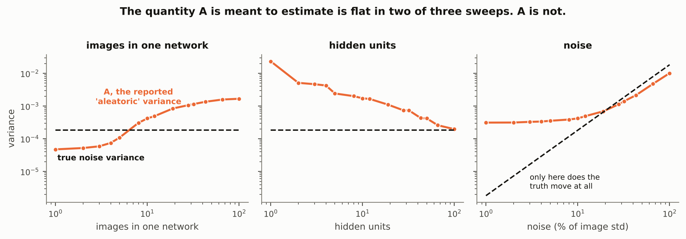
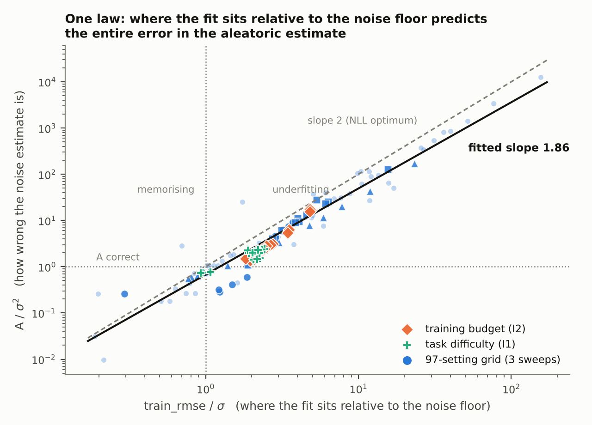
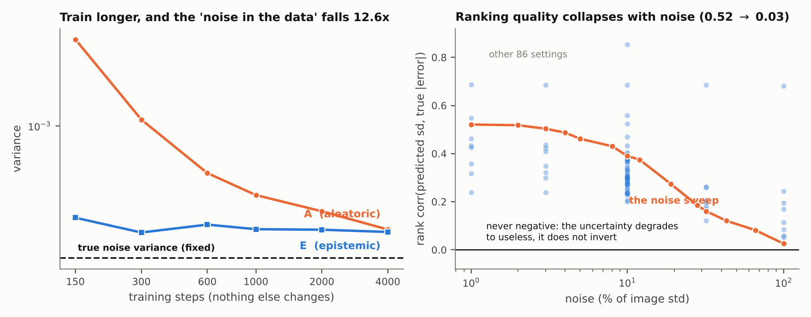

# The aleatoric head is a residual meter

**One law behind three sweeps.** A pre-registered study of what an implicit neural
representation's uncertainty outputs actually measure, built on a world where the truth is
known everywhere.

---

## The claim

An INR trained with a Gaussian negative-log-likelihood head reports two numbers: `A`, the
mean predicted variance, read as *aleatoric* uncertainty — noise in the data — and `E`, the
variance of an ensemble's predicted means, read as *epistemic* uncertainty — what the model
does not know.

`A` does not measure noise. It measures **where the fit sits relative to the noise floor**.
`A/σ²` is a power law in `train_rmse/σ` with exponent ≈ 2, which is exactly the optimum of
the NLL term it is trained on, and that one relation accounts for the whole behaviour of `A`
across 97 settings spanning 679× — settings that currently read as three separate findings
about data volume, capacity and noise.

The consequences are not small. Over a 97-setting grid, `A` lands within 1.5× of the true
noise variance in **13%** of settings. Training the *same model* on the *same data* for 27×
longer cuts the reported "noise in the data" by **12.6×**, while the true noise is fixed by
construction.

---

## How the argument runs

Each section answers one question and removes one alternative explanation. Nothing here is a
sweep for its own sake.

| § | Question | Decided by | Removes |
|---|---|---|---|
| [1](#1--the-anomaly) | Is `A` estimating noise? | 97-setting grid, σ² held fixed | that it is |
| [2](#2--one-law) | Are the three sweeps three findings? | the collapse, slope ≈ 2 | that they are |
| [3](#3--causal-test) | Correlation or cause? | two interventions, pre-registered | confounding |
| [4](#4--is-e-any-better) | Is `E` the trustworthy half? | a model with an exact posterior | "use `E` instead" |
| [5](#5--can-a-better-estimator-fix-it) | Is this an estimation bug? | the errors cancel in the total | "fit it better" |
| [6](#6--what-it-costs) | Does any of it matter downstream? | ranking quality, coverage | "it's academic" |
| [7](#7--what-to-do-instead) | So what should a practitioner do? | — | hand-waving |

---

## The world



One INR, `f(x, y, image code) → (mean, log-variance)`, trained on `n` synthetic images at
once with a learned code per image and shared weights; 5 independent networks per setting,
trained as one batch. Each image is observed through noisy pixels; 20% of observed pixels
are held out for calibration; a central block is never observed in any image. The clean
image is analytic, so the error is known at any coordinate, and the noise level is set by
the experimenter.

Three knobs, 1 to 100 each: **n** images, network **width**, and observation **noise** as a
percentage of image standard deviation. 97 settings — three one-at-a-time sweeps plus three
pairwise heatmaps. Two further knobs are introduced in §3.

The key property: in the `n` and `width` sweeps the noise level is **unchanged by
construction**, so anything `A` does there is something it should not be doing.

---

## 1 — The anomaly

| version | `A` spans | corr(log σ², log `A`) | corr(log train_rmse², log `A`) | `A` within 1.5× of truth |
|---|---|---|---|---|
| v1 | 4.6e-05 – 2.9e-02 (637×) | **+0.391** | **+0.958** | 18% |
| v2 | 4.6e-05 – 3.1e-02 (679×) | **+0.354** | **+0.933** | 13% |
| v3 | 4.6e-05 – 3.1e-02 (679×) | **+0.354** | **+0.933** | 13% |

In the 48 settings where the noise knob sits at its baseline — σ² *identical by
construction* — `A` still ranges 4.75e-05 to 2.33e-02, a factor of **490**.

The quantity `A` is defined to estimate explains almost none of its variation. The training
residual explains nearly all of it. Three independent versions of the code agree.

---

## 2 — One law



The NLL term `0.5·(log v + r²/v)` is minimised at `v = r²`: the head's optimum is the squared
residual **on the training data**. It reports that residual whatever produced it, and equals
the noise variance only when the fit happens to sit exactly on the noise floor.

So `A/σ²` should be a power law in `train_rmse/σ` with exponent 2:

| version | fitted slope | 95% CI | R² | settings |
|---|---|---|---|---|
| v1 | **1.923** | [1.84, 2.00] | **0.955** | 97 |
| v2 | **1.864** | [1.74, 1.98] | **0.932** | 97 |
| v3 | **1.864** | [1.74, 1.98] | **0.932** | 97 |

One free parameter collapses 679× of variation onto a single line, in every version.

### Three regimes

Where the fit sits relative to the noise floor is the whole story, and it has a sign:

| regime | `train_rmse/σ` | settings | median `A/σ²` | where it happens |
|---|---|---|---|---|
| memorising | < 0.8 | 11 | **0.26×** | few images; a wide net on little data |
| matched | 0.8 – 1.25 | 13 | **0.75×** | a narrow band only |
| underfitting | > 1.25 | 73 | **9.78×** | many images; narrow nets; short training |

A model that has fitted *below* the noise floor reports too little noise, because it has
absorbed the noise into its weights. A model that has not reached the floor reports its own
misfit as a property of the world. `A` is a usable noise estimate in 13 of 97 settings.

---

## 3 — Causal test

The collapse is still a correlation across settings that differ in several ways at once. Two
interventions, both pre-registered in [`preregistration.md`](preregistration.md) before they
were run, make it causal. Baseline `n=10, width=50, noise=10`; 3 seeds; full fidelity.

**I1 — task difficulty.** The `DIVERSITY` knob scales how much the images differ from one
another: a harder job at *identical* capacity, data volume and noise. It exists in the
original code and was never swept.

| diversity | `train_rmse/σ` | `A` | σ² | **`A/σ²`** |
|---|---|---|---|---|
| 0 | 0.99 | 1.168e-04 | 1.569e-04 | **0.74×** |
| 0.5 | 2.17 | 2.451e-04 | 1.666e-04 | **1.47×** |
| 1 | 2.34 | 4.114e-04 | 1.831e-04 | **2.25×** |
| 2 | 2.16 | 5.491e-04 | 2.414e-04 | **2.27×** |
| 3 | 1.94 | 6.746e-04 | 3.257e-04 | **2.07×** |

Spearman ρ(diversity, `A`) = **+0.982**, range **6.4×**. **H1 accepted.** With every image
identical, the network's job is easy, the fit lands on the noise floor, and `A` is almost
right (0.74×). Make the images differ and the "noise estimate" climbs — though the images'
noise never changed.

**I2 — optimisation budget.** Changes nothing about the data, the model, or the noise. Only
how far the fit is taken. The cleanest probe available.

| steps | `train_rmse/σ` | `A` | σ² | **`A/σ²`** | `E` |
|---|---|---|---|---|---|
| 150 | 4.83 | 3.033e-03 | 1.831e-04 | **16.56×** | 3.076e-04 |
| 300 | 3.49 | 1.084e-03 | 1.831e-04 | **5.92×** | 2.544e-04 |
| 600 | 2.64 | 5.455e-04 | 1.831e-04 | **2.98×** | 2.815e-04 |
| 1000 | 2.34 | 4.114e-04 | 1.831e-04 | **2.25×** | 2.655e-04 |
| 2000 | 2.14 | 3.340e-04 | 1.831e-04 | **1.82×** | 2.637e-04 |
| 4000 | 1.95 | 2.643e-04 | 1.831e-04 | **1.44×** | 2.562e-04 |

Spearman ρ(steps, `A`) = **−0.981**, range **12.6×**. **H2 accepted.** σ² is pinned at
1.831e-04 throughout. The amount of noise a model reports in its data is a function of how
long you trained it.

**H3 — same law.** Pooled over both interventions (33 runs): slope **1.939** [1.53, 2.48],
R² **0.882**. The observational grid gave 1.864. Theory says 2. **Accepted** — the
interventions land on the line the grid already drew (orange and green in the figure above).

**H4 — training residual, or error in general?** `train_rmse²` predicts `A` to 2.22×,
`err²` at held-out points to 2.74×. **Accepted**, but with a note against ourselves: on these
33 runs σ² alone scores 2.14×, better than both. That is expected and does not rescue it —
the interventions sit at one point of the grid, so σ² barely varies and a constant fits
adequately. The grid is where the comparison bites, and there σ² correlates +0.354 against
the residual's +0.933.

**H5 — the falsifier, and it fired.** We pre-registered that `E` must *not* obey the same
law, or the mechanism is not specific to the aleatoric head. Pooled over both interventions,
`E` gives slope **1.382**, R² **0.638** — not flat enough. **H5 rejected as written.**

A post-hoc split (labelled as such) shows what the pooled test conflated: `I1` changes the
images, which genuinely changes how much there is to disagree about, and also moves σ², since
the noise knob is a percentage of image standard deviation. Only `I2` isolates the head.

| runs | `A`: slope, R² | `E`: slope, R² | `A` range | `E` range |
|---|---|---|---|---|
| **I2** | 2.64, 0.987 | 0.14, 0.294 | **12.6×** | **1.4×** |
| **I1** | 1.21, 0.827 | 2.43, 0.970 | 6.4× | 12.3× |

Under `I2` alone — train 27× longer, change nothing else — `A` moves 12.6× and `E` moves
1.4×. That is the asymmetry the mechanism predicts. But it is a post-hoc rescue of a
pre-registered test that failed, and it is weaker evidence than a pass would have been. The
honest reading: `I1` was never a clean probe of the aleatoric head, and writing the pooled
test down was our error.

---

## 4 — Is `E` any better?

`E` is the spread of an ensemble's predicted means, read as the model's own ignorance. A
companion study replaces the trained layers above the INR's fixed random Fourier features
with a Bayesian linear head — **random-feature Bayesian linear regression**, a close analogue
with a posterior in closed form — so the true epistemic variance is computable rather than
estimated. 30 draws, ensembles of 2 to 50.

| ensemble members differ by | estimate / true epistemic variance at M = 50 | error decays as |
|---|---|---|
| exact posterior samples | **1.00×** | M^−0.457 (theory −0.5) |
| random initialisation *(what a deep ensemble does)* | **0.44×** | M^−0.102 — a floor |
| bootstrap resampling | **6.72×** | a floor |

An ensemble's spread estimates the variance of whatever distinguishes its members. That
equals the posterior's epistemic variance only when the members *are* posterior samples, and
they are not. The two standard constructions miss by constants that more members do not
reduce, in opposite directions — so there is no correction factor a practitioner could apply
without already knowing the answer.

In the same model, doubling the observation noise multiplies the *exact* epistemic variance
by 3.63 against an analytic ceiling of 4.00. A purely aleatoric intervention moves the
epistemic term by a factor of four with both terms computed exactly. The entanglement is in
the definition, not the estimator.

---

## 5 — Can a better estimator fix it?

No, and this is the section that says why the obvious response is the wrong one.

| quantity (exact-posterior study, M = 50) | estimate / truth |
|---|---|
| epistemic term | 0.44× |
| aleatoric term | 1.43× |
| **total predictive variance** | **1.10×** |

The two errors run in opposite directions and largely cancel. The undecomposed total is the
best-estimated quantity on the page, and the INR grid says the same thing from the other
side: its `rho_rank(A, E)` — whether the two terms move together across points within a
setting — has median **+0.457** and reaches **−1.000**. The split is not merely noisy; its
sign is unstable.

Splitting a quantity you can estimate to within 10% into two parts you can estimate to within
a factor of two to three is a poor trade unless the split buys something. §6 asks whether it
does.

---

## 6 — What it costs



`rho_std_err` is the rank correlation, per setting, between the predicted total standard
deviation and the true absolute error: does the uncertainty point at the mistakes?

- Across the grid: **+0.03 to +0.85**, median **+0.31**.
- It is **never negative** in any of the 96 settings. The uncertainty degrades to
  uninformative; it does not invert. *(An earlier draft of this analysis claimed an inversion
  at width 1. That conflated two different recorded correlations and is corrected here.)*
- Correlation with the noise knob: **−0.64**, falling from +0.52 at 1% noise to **+0.03** at
  100% — exactly where a user most wants a warning.

And from the exact-posterior study, on the region a model never observed: across
statistically identical draws the true extrapolation error inside an unobserved block varies
**7.4×** while the predicted uncertainty there varies **1.9×**, and the two are uncorrelated
(r = −0.01, against r = −0.75 for the actual error). Conformal calibration fixes the marginal
number exactly — 0.900 nominal, inside [0.88, 0.92] in 27 of 30 draws — and leaves regional
coverage swinging between **0.24 and 0.97**. Marginal guarantees are marginal.

---

## 7 — What to do instead

Each line traces to a section.

1. **Report the total, not the split.** The total is accurate to ~1.10×; the parts to 0.44×
   and 1.43×, with unstable sign. (§5)
2. **Report `train_rmse/σ` beside any aleatoric number, or do not report one.** It is the
   single statistic that says whether `A` means anything, and it is free. Below 0.8 the
   model has absorbed the noise; above 1.25 it is reporting its own misfit. (§2)
3. **Never compare `A` across models, training budgets, or dataset sizes.** 27× more training
   changes it 12.6× with the data untouched. Any such comparison is measuring the fit, not
   the data. (§3)
4. **Do not add ensemble members to improve the epistemic estimate.** The error has a floor
   that `M` does not reduce; members buy precision on the wrong estimand. (§4)
5. **Treat conformal coverage as the marginal guarantee it is.** It says nothing about any
   region, least of all one with no data. (§6)
6. **For a known-noise check, hold out a region and compare.** `A` is trustworthy only where
   the fit sits on the noise floor, and that is checkable. (§2)

---

## What this does not show

- **Synthetic images, one family.** The noise really is Gaussian and heteroscedastic as the
  model assumes. Real misspecification would likely make this worse, not better.
- **Two model families, and one of them is an analogue.** Random-feature Bayesian linear
  regression resembles the INR, it is not the INR; its exactness comes from linearity in the
  weights, and a trained INR's ensembles fail to be posterior samples in a different way.
- **`E` was not given the same causal treatment as `A`.** §4's mechanism is established in
  the analogue; in the INR itself we have only `I2`'s asymmetry, post-hoc.
- **The pre-registered falsifier failed.** §3's `M1` survives on a post-hoc split, which is
  weaker than a pre-registered pass, and is reported as such rather than quietly rewritten.
- **A latent bug in the image generator, found here, not fixed.** At `DIVERSITY = 4` the
  blob-width term `0.020·(1 + D·U(−0.3, 0.3))` goes negative for 8 of 100 images, flipping a
  Gaussian into a divergent exponential and producing non-finite pixels. The family is well
  defined only for `D < 3.33`. `D = 4` was replaced by `D = 3` and the failure documented.
  Any future sweep of that knob would be silently corrupted.

---

## Reproduce

```bash
pip install -r requirements.txt
python3 run_interventions.py both     # I1 + I2, ~21 min on 2 CPU cores
python3 analyse.py                    # grid law + H1-H5 -> RESULTS.md
python3 make_figures.py               # figures/
```

The observational sections read the completed 97-setting grids (`all_settings.json` for v1,
v2 and v3) produced by the original study; the interventions import that study's own model,
data and metrics from `inr_core.py` unmodified, so they drop into its grid directly.

| file | what it is |
|---|---|
| `preregistration.md` | hypotheses, thresholds, decision rules, and what would falsify the mechanism |
| `inr_core.py` | the original study's model, world and metrics, extracted unchanged |
| `run_interventions.py` | I1 and I2 |
| `analyse.py` | the grid law and H1–H5 |
| `make_figures.py` | the three figures |
| `RESULTS.md` | generated output, including the failed hypothesis |

---

*Author withheld for anonymous review, 2026. Synthetic data, CPU and one laptop GPU. A pre-registered result about
what two widely reported numbers actually measure, on a controlled test bed — not a general
claim about uncertainty quantification.*
